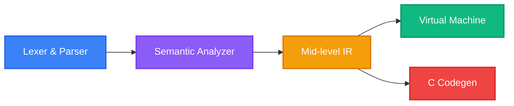

<div align="center">
  <div style="width: 100px; height: 100px; background: #6366f1; border-radius: 20px; display: flex; align-items: center; justify-content: center; font-size: 64px; color: white; font-weight: bold; margin: 0 auto 20px auto;">Y</div>
  
  # Young Kazah Language (YKL)
  
  **Системный язык программирования следующего поколения**<br/>
  *Zero-cost абстракции, memory safety и нативный C FFI без сборщика мусора.*

  []()
  []()
  []()
  
  <br/>
  <b>Создатель: Айтжан Али</b>
</div>

<br/>

## рџЊџ РћР±Р·РѕСЂ

YKL — это современный, статически типизированный системный язык программирования, разработанный с нуля для обеспечения высокой производительности и безопасности. Он компилируется в оптимизированный код на языке C11, что позволяет напрямую и без накладных расходов взаимодействовать с API операционных систем.

## ✨ Ключевые особенности

- 🛡️ **Borrow Checker**: Безопасность памяти на этапе компиляции. Отсутствие Garbage Collector (сборщика мусора). �сключает ошибки Use-After-Move и Borrow Conflicts.
- 🚀 **C-Codegen FFI**: Вызов нативного C кода напрямую. Полная трансляция в C11 для максимальной скорости.
- 📦 **Go-Style Package Manager**: Автоматическое управление зависимостями (Zero configuration). `import "github.com/user/repo"` работает "из коробки".
- 🧬 **Algebraic Data Types**: Поддержка типов `Result<T, E>` и `Option<T>` с мощным сопоставлением с образцом (Pattern Matching).
- 🛠️ **Встроенный Tooling**: Включает в себя Language Server (`apl_lsp`), удобный CLI (`apl_cli`) и встроенный линтер (Linter).

## 🏗️ Архитектура



## 💡 Почему YKL? (Сравнение с конкурентами)

YKL берет лучшие идеи из индустриальных стандартов, избавляясь от их главных недостатков. Это делает его идеальным выбором для современных Enterprise и System задач.

*   **vs C:** Вместо ручного управления памятью (которое ведет к утечкам и segfault-ам) YKL предлагает **Borrow Checker** на этапе компиляции, сохраняя при этом 100% совместимость с C ABI и нативную скорость.
*   **vs C++:** YKL предоставляет Zero-Cost абстракции (Дженерики, Algebraic Data Types, Pattern Matching), но избавлен от десятилетий легаси (header-файлы, `#include`), предлагая минималистичный синтаксис и настоящие модули.
*   **vs Rust:** YKL дает **80% безопасности Rust за 20% сложности**. Наш Borrow Checker ловит критические ошибки (Use-After-Move, Mutability), но не заставляет разработчика "воевать" с компилятором. Плюс встроенная VM позволяет мгновенно тестировать код.
*   **vs Go (Golang):** YKL так же прост и имеет аналогичный Package Manager, но **не использует Garbage Collector (Сборщик мусора)**. Это открывает YKL путь в жесткое системное программирование (ОС, драйверы, микроконтроллеры), где паузы GC недопустимы.

## 🚀 Быстрый старт

### 1. Сборка компилятора
```bash
cargo build --release
```

### 2. Запуск программы на YKL
```bash
cargo run --bin apl -- run src/main.yk
```

### Пример: TCP Сервер на YKL
```rust
import "github.com/ykl/std/net";
import std::result;

fn main() -> i32 {
    let server_fd = unwrap_or(net_tcp_server(8080), -1);
    if server_fd == -1 {
        return 1;
    }
    
    let client_fd = unwrap_or(net_accept(server_fd), -1);
    let buf = unwrap_or(net_recv_raw(client_fd, 1024), 0);
    
    if buf != 0 {
        printf("%s\n", buf);
        free(buf); // Прямой вызов FFI!
    }
    return 0;
}
```

## 🗺️ V2 Roadmap & Текущий Статус

- [x] **Generics (Дженерики)**: Вывод типов для надежных структур данных.
- [x] **Package Manager**: Автоматическое клонирование зависимостей с Github.
- [x] **Namespaces (Пространства имен)**: �ерархическая структура модулей (`std::net::tcp`).
- [x] **Linter & LSP**: Диагностика неиспользуемых переменных и конфликтов Borrow Checker-а в реальном времени.
- [x] **File & Network I/O**: Тестирование языка (Dogfooding) через реализацию POSIX FFI.
- [ ] **Traits / Interfaces**: Динамический полиморфизм и ограничения дженериков.
- [ ] **Stack Enums**: Плоская структура памяти для Zero-Cost алгебраических типов.
- [x] **Официальный Formatter**: Встроен форматировщик кода `apl_fmt`.
