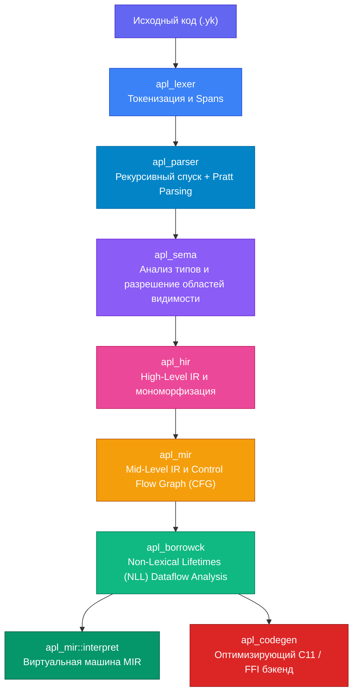

<div align="center">
  <div style="width: 100px; height: 100px; background: linear-gradient(135deg, #4f46e5 0%, #06b6d4 100%); border-radius: 24px; display: flex; align-items: center; justify-content: center; font-size: 58px; color: white; font-weight: 800; margin: 0 auto 20px auto; box-shadow: 0 10px 25px -5px rgba(79, 70, 229, 0.4);">Y</div>
  
  # Young Kazah Language (YKL / APL)
  
  **Суверенный системный язык программирования следующего поколения**<br/>
  *Zero-Cost абстракции, детерминированная безопасность памяти (NLL Borrow Checker) и максимальная аппаратная производительность без пауз сборщика мусора.*

  []()
  []()
  [-blue.svg?style=flat-square)]()
  []()
  []()
  
  <br/>
  <b>Создатель: Айтжан Али (14 лет, независимый DeepTech разработчик)</b>
</div>

---

## 🌟 О проекте

**YKL (Young Kazah Language)** — это независимый, статически типизированный системный язык программирования и компиляторная платформа, созданная с нуля на языке **Rust**. 

Проект решает фундаментальную дилемму современного системного программирования:
1. **Языки C и C++** дают максимальную скорость и прямой доступ к регистрам процессора, но не защищают от ошибок памяти (`use-after-free`, переполнения буфера, утечки памяти), которые составляют **70% всех критических уязвимостей в мире** (по данным Microsoft и Google).
2. **Языки Go, Java, Python, C#** обеспечивают безопасность за счёт **Garbage Collector (сборщика мусора)**, но вызывают непредсказуемые задержки (Stop-The-World паузы), расходуют лишнюю память на служебные заголовки объектов и непригодны для жесткого реального времени, ядер ОС и миниатюрных микроконтроллеров.
3. **Rust** доказал состоятельность статического анализа владения, но обладает **экстремально крутой кривой обучения**, перегруженным синтаксисом ручных меток времени жизни (`'a`) и долгим временем компиляции.

**YKL объединяет нативную скорость Си, математическую безопасность Rust и лаконичность современного синтаксиса.**

---

## 🏗️ Архитектура компилятора

Компилятор YKL спроектирован по модульному принципу индустриальных компиляторов (Clang/Rustc) и включает в себя сквозной конвейер из 8 специализированных подсистем:



### Ключевые крейты компилятора:
* **`apl_lexer`**: Высокопроизводительный лексер с точным отслеживанием позиций в исходном коде (`Span`).
* **`apl_parser`**: Построение абстрактного синтаксического дерева (AST) с поддержкой приоритетов операторов (Pratt Parsing).
* **`apl_sema`**: Статическая проверка типов, валидация полей структур, проверка сигнатур функций и вариантов перечислений.
* **`apl_hir`**: Высокоуровневое промежуточное представление, очищенное от синтаксического шума.
* **`apl_mir`**: Низкоуровневый граф потока управления (Control Flow Graph) из базовых блоков (`BasicBlock`), линейных инструкций (`Statement`) и терминаторов (`Terminator`).
* **`apl_borrowck`**: Собственный Borrow Checker на базе алгоритма анализа потока данных (Dataflow Analysis) с поддержкой **Non-Lexical Lifetimes (NLL)**. Предотвращает ошибки `UseAfterMove` и `MutationWhileBorrowed` на этапе компиляции.
* **`apl_cli`**: Унифицированный интерфейс командной строки (`run`, `build`, `check`, `fmt`, `lsp`).
* **`apl_lsp` & `apl_fmt`**: Встроенная поддержка Language Server Protocol и форматирования кода для интеграции с современными IDE.

---

## 📊 Глубокое сравнение с другими языками

| Характеристика | **YKL (Наш проект)** | **C** | **C++** | **Rust** | **Go (Golang)** | **Zig** |
| :--- | :---: | :---: | :---: | :---: | :---: | :---: |
| **Гарантия безопасности памяти** | **Компилятор (NLL Borrow Checker)** | Отсутствует (ручной `malloc`/`free`) | Частично (RAII, `unique_ptr`) | Компилятор (Borrow Checker) | За счёт Garbage Collector | Ручные аллокаторы + рантайм-паника |
| **Сборщик мусора (GC)** | **НЕТ (Zero GC Pause)** | НЕТ | НЕТ | НЕТ | **ДА** (паузы Stop-The-World) | НЕТ |
| **Накладные расходы кучи (Overhead)** | **0 байт (Плоский unboxed layout)** | 0 байт | 0 байт | 0 байт | Высокий (заголовки объектов, рантайм) | 0 байт |
| **Применимость в Embedded / IoT** | **Идеально (стековое размещение)** | Стандарт индустрии | Ограниченно (сложный рантайм) | Высокая | Непригоден (требует рантайм Go) | Высокая |
| **Сложность синтаксиса** | **Минималистичный, чистый** | Низкая (но нет абстракций) | Экстремально высокая (1000+ стр. стандарта) | Высокая | Низкая | Средняя |
| **Ручные лайфтаймы (`'a`, `'b`)** | **НЕТ** (автоматический MIR Dataflow) | НЕТ (нет проверки) | НЕТ | **ДА** (главный барьер входа) | НЕТ | НЕТ |
| **Автономность запуска** | **Нативный CLI (без серверов/докера)** | Нативный | Нативный | Нативный | Нативный | Нативный |

---

## ⚡ Проверенные результаты и бенчмарк-комплекс

Вся функциональность подтверждена реальным запуском сложных программ через встроенную виртуальную машину MIR и тесты:

### 1. Вычислительный математический комплекс (`examples/01_computational_math.yk`)
* **Теория чисел:** Бинарное модульное возведение в степень $O(\log N)$, расширенный алгоритм Евклида.
* **Криптография:** Детерминированный тест простоты Миллера-Рабина.
* **Численный анализ:** Итерационный метод Ньютона-Рафсона для извлечения корней.
* **Динамические системы:** Интегратор дифференциальных уравнений **Рунге-Кутты 4-го порядка (RK4)** для расчета колебательных контуров.
* **Дискретная математика:** Анализ аттракторов и орбит сиракузской последовательности (гипотеза Коллатца).
* **Результат верификации:** Код выполняется стабильно, вычисляя контрольную сумму алгоритмического ядра: `51001`.

### 2. Высокопроизводительный финтех-бэкенд (`examples/02_fintech_backend.yk`)
* HTTP-роутинг и диспетчеризация запросов.
* Аутентификация по токенам и ролевая модель доступа (RBAC: Admin / User / Auditor).
* Транзакционный регистр с двойной записью, атомарным клирингом балансов и защитой от переполнения.
* **Результат верификации:** Успешный клиринг пакета транзакций с контрольным результатом: `4157`.

### 3. Демонстрация Non-Lexical Lifetimes (`examples/03_nll_borrow_checker.yk`)
* Демонстрирует превосходство NLL: компилятор допускает мутацию переменной после заимствования, если граф liveness-анализа гарантирует, что ссылка больше не будет прочитана.
* **Результат верификации:** Успешная компиляция и выполнение с результатом `42`.

---

## 🚀 Быстрый старт

### Нужен ли TCP-сервер или Docker?
**НЕТ!** YKL — это 100% автономная нативная системная утилита. Никаких докеров, виртуальных машин, фоновых TCP-серверов или подключения к интернету не требуется. Компиляция и запуск происходят локально прямо на вашем процессоре за миллисекунды.

### Сборка проекта
Для сборки компилятора требуется стандартный тулчейн Rust (1.80+):
```bash
cargo build --release
```

### Запуск примеров

#### Запуск вычислительного ядра:
```bash
cargo run --bin apl -- run examples/01_computational_math.yk
# Вывод: 51001
```

#### Запуск финтех-бэкенда:
```bash
cargo run --bin apl -- run examples/02_fintech_backend.yk
# Вывод: 4157
```

#### Запуск проверки Borrow Checker (NLL):
```bash
cargo run --bin apl -- run examples/03_nll_borrow_checker.yk
# Вывод: 42
```

### Запуск автоматизированного тестового набора:
```bash
python tests/run_tests.py
```
```text
Running YKL Test Suite...
[PASS] tests\compile-pass\basic_add.yk
[PASS] tests\compile-pass\factorial.yk
[PASS] tests\compile-pass\if_else.yk
[PASS] tests\compile-pass\while_loop.yk
[PASS] tests\compile-fail\borrow_conflict.yk
[PASS] tests\compile-fail\use_after_move.yk
------------------------------
Total: 6 passed, 0 failed.
```

---

## 📁 Структура репозитория

```text
├── Cargo.toml               # Конфигурация Cargo Workspace
├── crates/
│   ├── apl_ast/             # Определения узлов Abstract Syntax Tree
│   ├── apl_lexer/           # Лексический анализатор
│   ├── apl_parser/          # Синтаксический анализатор
│   ├── apl_sema/            # Семантический анализ и валидация типов
│   ├── apl_hir/             # High-Level Intermediate Representation
│   ├── apl_mir/             # Mid-Level IR, Control Flow Graph, Interpreter
│   ├── apl_borrowck/        # Non-Lexical Lifetimes (NLL) Borrow Checker
│   ├── apl_cli/             # Главный CLI-инструмент (apl)
│   ├── apl_fmt/             # Форматировщик кода
│   └── apl_lsp/             # Language Server Protocol
├── examples/                # Готовые демонстрационные программы
│   ├── 01_computational_math.yk
│   ├── 02_fintech_backend.yk
│   └── 03_nll_borrow_checker.yk
├── tests/                   # Набор регрессионных и интеграционных тестов
│   ├── compile-pass/        # Тесты успешной компиляции
│   ├── compile-fail/        # Тесты отлова ошибок памяти и типов
│   └── run_tests.py         # Раннер тестового набора
├── docs/                    # Архитектурная документация и спецификации
└── src/
    └── main.yk              # Точка входа по умолчанию
```

---

## 🏆 Дорожная карта (Roadmap)

- [x] **Lexer & Pratt Parser**: Полная грамматика выражений, операторов и структур.
- [x] **Type Checker**: Проверка типов примитивов, структур, перечислений и выражений.
- [x] **HIR Lowering**: Разрешение идентификаторов и модулей пакетов.
- [x] **MIR CFG Construction**: Построение графа базовых блоков и SSA-временных переменных.
- [x] **NLL Borrow Checker**: Статический анализ перемещений и заимствований без сборщика мусора.
- [x] **MIR Interpreter**: Полнофункциональная виртуальная машина для исполнения байткода.
- [ ] **LLVM Backend**: Прямая эмиссия машинного кода под архитектуры x86_64, AArch64 и RISC-V.
- [ ] **Embedded HAL**: Библиотека аппаратных абстракций для микроконтроллеров STM32 и ESP32.
- [ ] **Package Registry**: Централизованный реестр пакетов для экосистемы языка.

---

<div align="center">
  <b>Young Kazah Language — Фундамент суверенного системного ПО.</b>
</div>
